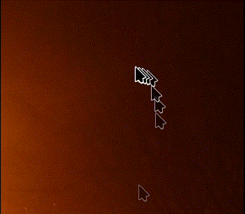
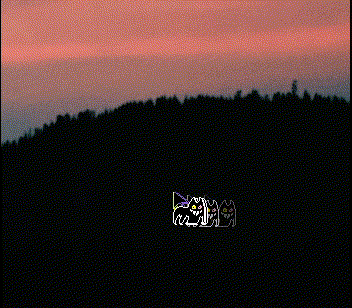

## Cursor trail effect for KDE Plasma 6

This effect introduces the cursor trail effect from Windows, with the addition of the trails fading out of view. They can be configured in both duration and frequency.

Tested on KDE Plasma 6.8.2 CachyOS





## Building

### Dependencies

- CMake
- extra-cmake-modules
- Ninja (optional)

```bash
$ cd path/to/this/repo
$ cmake -DCMAKE_INSTALL_PREFIX=/usr -G Ninja -B build . # '-G Ninja' is optional, but recommended for faster compilation
$ cmake --build build
$ sudo cmake --install build
```
easiest way to install is to set install.sh as executable and execute it from terminal.
